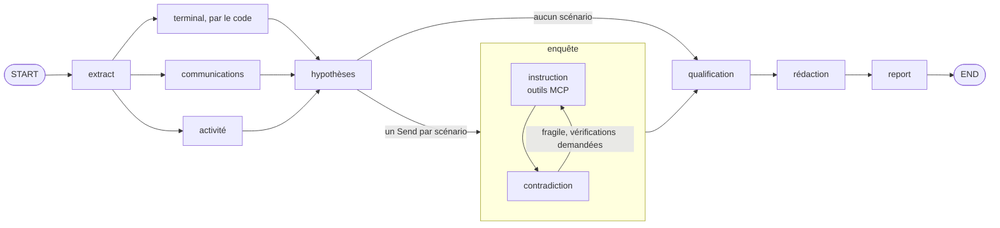

# Harness forensique iOS — LangGraph + iLEAPP-MCP + LLM local

Pipeline d'analyse d'une sortie [iLEAPP](https://github.com/abrignoni/iLEAPP) par un modèle de
langage local. L'extraction des preuves est déterministe (serveur `iLEAPP-MCP`, lecture seule) ;
le modèle ne fait que raisonner sur ce qui lui est fourni.

## Graphe



Toutes les données du cas viennent du serveur **iLEAPP-MCP** : le harness ne lit aucun fichier du cas
pour l'analyse (seule l'empreinte de chaîne de possession est calculée par le harness lui-même).

- `extract` lit, par nom exact d'artefact iLEAPP (`forensic_harness/extract.py`, table `SOURCES`),
  une cinquantaine d'exports choisis pour l'enquête : identité du terminal, comptes, applications
  installées, indices d'effacement, réglages de conservation, messageries, courriels,
  notifications, agenda, partages de fichiers, cloud, recherches, navigation, notes, lieux. Toutes
  leurs lignes sont lues, sans plafond. Les autres exports (environ 200 sur le cas public) restent
  accessibles à l'enquête par les outils.
- **Fiche du terminal** : relevée par le code, sans modèle (`profile.py`). Chaque ligne recopie des
  champs des preuves qu'elle cite (identifiants, numéro, comptes, réseaux, appareils appairés) ; les
  mots de passe et codes restent dans leur preuve. Les applications de catégories sensibles
  (messageries chiffrées, VPN et coffres, cryptomonnaie) sont nommées en contexte : une application
  installée n'ouvre pas de scénario à elle seule.
- **Lecture** : deux agents en parallèle lisent tout le reste, conversation par conversation, par lots qui
  tiennent dans le contexte. Le code compacte sans rien retirer de citable : valeurs communes à toute
  une conversation dites une fois, lignes consécutives identiques aux dates près réunies (avec toutes
  leurs références et toutes leurs dates), identifiants internes omis. Gain modeste (−8 % de texte sur
  le cas public) : une ligne à plusieurs dates ou séparée par une réponse n'est jamais réunie. Les agents
  classent chaque constat dans une taxonomie générale de comportements (`signal` : contexte,
  pression, contrepartie, information sensible, transfert, canal discret, dissimulation, faux, accès
  tiers, autre comportement possiblement illégal). La lecture est neutre : elle décrit, elle ne qualifie pas.
- **Hypothèses** : l'enquêteur principal relie les signaux en 0 à 4 scénarios, chacun fondé sur au
  moins deux preuves, avec les vérifications à faire. Sans signal de comportement, aucun appel.
- **Enquête**, un sous-graphe par scénario, en parallèle (`forensic_harness/investigate.py`) :
  `instruction` interroge le dossier avec trois outils en lecture seule servis par iLEAPP-MCP
  (`rechercher` → `global_keyword_search`, `lire_source` → `get_raw_artifact_data` sur une période,
  `lire_fichier` → `get_file_attachment`, texte des pièces jointes, PDF et DOCX compris), puis rend
  ses constats **à charge et à décharge** ; `contradiction` joue la défense (explications innocentes,
  preuves mal lues, lacunes) et rend un verdict `etaye`, `fragile` ou `non_etaye`. Un scénario fragile
  est instruit une fois de plus avec les vérifications demandées. Le verdict est plafonné par le code :
  pas de scénario étayé sans deux éléments à charge vérifiés citant deux preuves distinctes, dont au
  moins un fait ou une inférence ; pas de scénario retenu sans aucun (le contradicteur n'est alors pas
  appelé). Sous `--since/--until`, `lire_fichier` est refusé : un fichier n'est pas daté.
- **Qualification** : pour les scénarios retenus, rapprochement avec un catalogue d'infractions
  (`qualifications_ch.json`, droit suisse, **projet à faire valider par un juriste**) : éléments
  constitutifs soutenus par les preuves, éléments manquants (recopiés du catalogue, sinon écartés).
  La qualification revient au magistrat.
- **Rédaction** : synthèse, terminal et utilisateur, récit chronologique de chaque scénario retenu,
  actes d'enquête suggérés. Chaque phrase est un constat contrôlé.
- `report` assemble le rapport par du code, à partir des seuls constats vérifiés.

## Traçabilité

Chaque ligne de preuve, lue à l'extraction ou rendue par un outil pendant l'enquête, porte une
référence interne `E<n>` et la provenance que lui donne le serveur MCP. Chaque agent rend des
constats structurés (`fait`, `inference` ou `hypothese`) qui citent ces références et, s'il le
souhaite, un passage recopié. Un contrôle automatique (`forensic_harness/validate.py`, du code)
rejette un constat :

- qui ne cite aucune preuve, quelle que soit sa nature ;
- qui cite une référence inexistante, ou une preuve qui n'a pas été montrée à cet agent ;
- dont la citation ne se retrouve pas dans une preuve citée ;
- qui glisse dans son texte une référence non déclarée (y compris sous une forme imitée : `e12`,
  `E-12`, lettre grecque) ou une référence du rapport (`P3`), ou qui dépasse 500 caractères ;
- dont les champs propres à l'agent sont invalides (catégorie de signal, numéro de scénario,
  qualification hors catalogue…).

Un agent dont des constats sont rejetés est relancé une fois avec les motifs ; ce qui reste rejeté
n'est ni transmis à la suite ni imprimé (détail dans `findings.json`). Le rapport n'imprime que des
constats vérifiés : les titres de scénario, questions du contradicteur et limites déclarées par les
agents, textes libres non vérifiables, restent dans `findings.json` (un scénario s'appelle
« Scénario n » dans le rapport).

**Le rapport principal et ses preuves.** `report.md` ne cite que des références `P1…Pn`, numérotées
dans l'ordre où elles apparaissent. `preuves.json`, à côté du rapport, contient **exactement** ces
preuves-là, et rien d'autre : pour chacune, l'identifiant `EV-…` et l'empreinte de la ligne calculés
par le serveur MCP, l'export, le numéro d'enregistrement, le fichier iOS d'origine, l'horodatage UTC,
le contenu exact vu par le modèle, l'appel MCP qui relit la ligne (`relire`) et les sections du rapport
qui la citent. C'est le seul fichier que l'analyste ouvre pour vérifier le rapport. L'ensemble de ce
que l'exécution a lu reste dans `extraction.json` (copie de travail scellée avec le reste).

**Ce que « vérifié » ne garantit pas.** Le contrôle établit que les références existent et que la
citation s'y trouve. Il ne lit pas le sens : un constat qui attribue un message à la mauvaise personne
en citant la bonne ligne passe. Le rapport reste à relire par un analyste, `preuves.json` en main.

Le rapport contient aussi la **portée de l'analyse** (exports lus, appels d'outils de l'enquête,
constats rejetés, anomalies d'exécution, couverture source par source). Les horodatages sont
normalisés en UTC ; une valeur sans fuseau est considérée UTC (convention iLEAPP).

## Installation

Les deux dépôts se clonent côte à côte (le harness dépend du serveur MCP en local) :

```
parent/
├── forensic-langgraph/   # ce dépôt
└── iLEAPP-MCP/
```

```bash
cd forensic-langgraph
uv sync                    # crée .venv à partir de uv.lock
cp .env.example .env && chmod 600 .env   # puis renseigner les clés Langfuse
uv run pytest              # tests sur un cas synthétique, sans modèle
```

## Utilisation

```bash
uv run python -m forensic_harness /chemin/vers/sortie_iLEAPP              # analyse, puis attend la validation (voir plus bas)
uv run python -m forensic_harness /chemin/vers/sortie_iLEAPP --plan      # coût prévu, sans appeler le modèle
uv run python -m forensic_harness /chemin/vers/sortie_iLEAPP --since 2025-12-01 --until 2025-12-20
uv run python -m forensic_harness /chemin/vers/sortie_iLEAPP --no-review # sans arrêt (essais, évaluation)
```

Le serveur d'inférence (llama.cpp, API compatible OpenAI) doit écouter sur `LLAMA_SERVER_URL`.
`--plan` affiche le nombre de lots et de tokens par domaine : à lancer avant tout gros dossier.
`--since` / `--until` restreignent l'analyse aux preuves datées dans la fenêtre (une date seule désigne
le jour entier ; les preuves sans date sont gardées ; ce qui est écarté est compté dans le rapport).
Une date illisible ou une fenêtre inversée est refusée.

Codes de sortie : 0 rapport produit sans anomalie, 2 anomalies relevées (elles sont dans le rapport),
3 analyse faite et en attente de la décision de l'analyste.

`CORRELATION_LOOKUPS=3` accorde à l'agent de corrélation quelques tours de recherche par mot-clé dans
le dossier (outil en lecture seule, chaque appel journalisé, chaque ligne trouvée référencée comme
preuve, fenêtre de dates respectée). Désactivé par défaut : chaque tour est un appel de plus au modèle.

## Validation humaine et chaîne de possession

Par défaut, l'analyse s'arrête avant le rapport. Elle écrit `report.draft.md` et affiche son empreinte.
L'analyste relit le brouillon références en main, puis donne sa décision **sur ce brouillon-là** :

```bash
uv run python -m forensic_harness --resume runs/<cas>/<exécution> --draft-sha256 <empreinte> --approve --analyst "Nom"
uv run python -m forensic_harness --resume runs/<cas>/<exécution> --draft-sha256 <empreinte> --reject --note "motif"
```

La reprise ne rappelle pas le modèle. Elle est refusée si le brouillon sur disque n'a pas l'empreinte
donnée, ou si l'état enregistré (constats, preuves extraites, manifeste) ne redonne plus ce brouillon :
le rapport final dit ce que disait le brouillon relu, avec la décision en tête — **validé** (nominatif),
**rejeté** (motivé) ou, avec `--no-review`, **non relu par un analyste**. Le nom de l'analyste est
déclaratif : rien ne l'authentifie.

Chaque exécution a son dossier `runs/<cas>/<horodatage UTC>/`, non versionné :

| Fichier | Contenu |
| :--- | :--- |
| `manifest.json` | empreinte SHA-256 de chaque fichier du dossier iLEAPP au début ; résultat des contrôles suivants ; commits des deux dépôts et versions des paquets ; build, arguments, image et chemin du fichier de modèle du serveur d'inférence ; température et graine ; empreinte des prompts ; décision de l'analyste et empreinte du brouillon relu ; empreinte de chaque fichier de l'exécution |
| `manifest.sha256` | empreinte du manifeste : **à consigner hors de la machine** (procès-verbal) |
| `report.md`, `report.draft.md` | rapport final et brouillon soumis à validation |
| `findings.json` | constats vérifiés et rejetés, mesures de chaque appel au modèle |
| `extraction.json` | preuves transmises, leur provenance, l'empreinte de chaque ligne, la couverture |
| `tool_calls.jsonl` | journal des appels au serveur MCP, avec l'empreinte de chaque résultat |
| `llm/` | chaque prompt envoyé et chaque réponse brute du modèle |
| `run.json`, `checkpoint.sqlite` | durée et anomalies ; point d'arrêt de la validation |

```bash
uv run python -m forensic_harness --verify runs/<cas>/<exécution> --manifest-sha256 <empreinte notée>
```

`--verify` recalcule l'empreinte de chaque fichier de l'exécution et celle du dossier de preuves, et
liste les écarts. Ce que le dispositif garantit, et ses limites :

- **Preuves.** L'empreinte couvre tout le dossier iLEAPP sauf `data/` (copie du système de fichiers
  de l'appareil) et `media/`. Elle est prise avant toute lecture, reprise juste après l'extraction et
  à la fin ; un écart est dit en tête du rapport. Une modification faite puis défaite entre deux
  contrôles ne se voit pas à ce niveau ; l'empreinte de chaque ligne lue est dans `extraction.json`.
- **Dossier d'exécution.** À la clôture, fichiers et dossiers passent en lecture seule et ne peuvent
  pas être réutilisés. Ce n'est pas un scellé : le propriétaire des fichiers peut rétablir l'écriture.
  La seule protection contre une réécriture complète est l'empreinte du manifeste notée ailleurs,
  que `--verify --manifest-sha256` compare.
- **Code.** Le manifeste consigne la version du code au début de l'analyse et à la production du
  rapport ; un changement entre les deux (reprise après modification) est signalé dans le rapport.
- **Modèle.** Le fichier de modèle est identifié par son chemin ; un blob Ollama porte son SHA-256
  dans son nom, le harness ne le recalcule pas. À température 0,1 et graine fixe, deux exécutions ne
  sont pas garanties identiques au mot près : l'évaluation mesure la dispersion.
- **Cache des réponses.** Une réponse complète du modèle (lecture, hypothèses, conclusions, rédaction)
  est gardée dans `runs/llm_cache.sqlite`, rangée par l'empreinte de la requête (taille, paramètres et
  gabarit du modèle et version du serveur, lus sur `/v1/models` et `/props` ; paramètres ; messages).
  La même requête la relit au lieu de relancer des heures de lecture ; le rapport dit combien de réponses viennent du cache. Les tours
  d'outils de l'enquête restent en direct. Un cache illisible, verrouillé ou plein est contourné, jamais
  une réponse perdue. `LLM_CACHE=` (vide) le coupe ; `evaluate --runs N` (N > 1) le coupe d'office.
- **Lecture seule côté preuves.** Le serveur MCP ouvre les bases en lecture seule et ne sert que le
  cas avec lequel il a été lancé ; le dossier d'exécution ne peut pas se trouver dans le dossier de
  preuves. Une exécution lancée depuis LangGraph Studio n'est pas clôturée : la clôture est faite par
  la ligne de commande.

## Évaluation

Un changement de prompt, de modèle ou d'extraction se juge sur des chiffres, pas à la lecture d'un rapport.

```bash
# rejoue le graphe 5 fois sur le cas de référence et note chaque exécution
uv run python -m forensic_harness.evaluate --dataset datasets/magnet_ground_truth.json \
    --case /chemin/iPhone14Plus-CTF-MAGNET-iLEAPP_Output --runs 5

# note des exécutions déjà produites (aucun appel au modèle)
uv run python -m forensic_harness.evaluate --dataset datasets/magnet_ground_truth.json --score runs/<cas>/<exécution>

# cas témoin sans incident : mesure les accusations inventées
uv run python -m forensic_harness.synthetic_case /tmp/synthetic-benign
uv run python -m forensic_harness.evaluate --dataset datasets/synthetic_benign.json --case /tmp/synthetic-benign --runs 3

# cas témoin ambigu (plaisanterie, remboursement, réinitialisation…) : aucun scénario ne doit être retenu
uv run python -m forensic_harness.synthetic_case /tmp/synthetic-ambiguous --ambigu
uv run python -m forensic_harness.evaluate --dataset datasets/synthetic_ambiguous.json --case /tmp/synthetic-ambiguous --runs 3

# vérifie que le jeu de données tient face au dossier (exports cités présents, valeurs retrouvées)
uv run python -m forensic_harness.evaluate --dataset datasets/magnet_ground_truth.json --case <dossier> --audit
```

Magnet sert aussi à régler les prompts : ses chiffres sont optimistes. `datasets/hickman_ios17.json` est
un cas public **tenu à l'écart** (jamais regardé pour régler quoi que ce soit) : l'image iOS 17 de
Joshua Hickman (Digital Corpora, `corpora/mobile/iOS17`), usage quotidien documenté, aucune infraction,
mais une quinzaine d'applications de confidentialité et une plaisanterie sur un « malware ». Elle
mesure les accusations inventées sur un vrai téléphone. Il faut d'abord la traiter avec iLEAPP vers
`~/cases/iOS17-Hickman-iLEAPP_Output`.

`infra/evaluation.sh <étiquette> [n]` rejoue les quatre cas n fois (3 par défaut) depuis un clone figé,
cache des réponses coupé (sinon la dispersion mesurée est nulle), et écrit `RESULTATS.md`.

| Mesure | Ce qu'elle dit |
| :--- | :--- |
| Scénarios attendus retrouvés | un scénario du jeu de données (`scenarios`) compte si un scénario **retenu** le décrit et si les preuves citées par son hypothèse, ses éléments à charge, son récit ou sa qualification contiennent le passage attendu |
| Scénarios retenus | sur un cas témoin, doit valoir 0 |
| Rappel du rapport principal | un fait compte s'il est énoncé dans un constat **imprimé dans le rapport** et présent dans une preuve que ce constat cite |
| Rappel de la lecture | même mesure sur tous les constats vérifiés de la lecture : l'écart avec le précédent est ce que la rédaction laisse de côté |
| Fait seulement énoncé | le fait est écrit quelque part, sans exiger la preuve : sert à comparer avec un ancien rapport en texte libre |
| Plafond de rappel | part des faits présents dans les preuves transmises : ce qui manque ici est un défaut d'extraction, pas de raisonnement |
| Source exacte | parmi les faits retrouvés, part dont la preuve vient de l'export attendu |
| Citations valides | part des constats acceptés par le contrôle automatique, au premier essai et après relance |
| Faits par constat, empilements | un constat qui couvre trois faits ou plus est un empilement de mots-clés |
| Accusations inventées | sur le cas témoin, constats affirmant un terme qui n'a rien à y faire (un terme nié dans sa proposition ne compte pas) |

**Limite à connaître.** Le rappel mesure le repérage et la citation, pas la compréhension : un modèle
qui recopie les bonnes lignes l'obtient. La détection se fait par chaîne de caractères ; elle ne voit
pas une phrase qui nie le fait (« aucun contact nommé X »). Ces chiffres servent à comparer deux
versions du système, pas à certifier un rapport.

Avec `--runs N`, le tableau donne la moyenne et l'étendue, et liste les faits qui ne sortent pas à
chaque exécution. `--gate seuils.json` fait échouer la commande sur régression ; une mesure absente
d'une exécution (exécution sans constat) fait échouer le seuil :

```json
{"min": {"scenario_recall": 0.66, "citation_validity": 0.9}}
```

et pour un cas témoin :

```json
{"max": {"invented_accusations": 0, "scenarios_retained": 0}}
```

`--report ancien_rapport.md` note un rapport en texte libre (faits énoncés seulement, aucune
traçabilité). Les résultats sont écrits dans `eval_results/` (non versionné). Si les clés Langfuse sont
renseignées, chaque exécution notée y est aussi inscrite comme expérience (`Datasets` → jeu → passage
nommé d'après le dossier d'exécution), avec toutes les mesures en scores : Langfuse en tire les tableaux
et graphiques de comparaison. Il ne fait que ranger : le graphe tourne ici, pas dans Langfuse. N'y partent
que les mesures, les identifiants de faits et de scénarios, et les chemins.

Le jeu `magnet_ground_truth.json` comptait des sources erronées (un export `Device Info.tsv` qui
n'existe pas dans le dossier, des valeurs attribuées à un fichier qui ne les contient pas) ; elles ont
été corrigées après audit, export par export, et l'entrée porte alors `source_audit`.

## Infrastructure

| Fichier | Rôle |
| :--- | :--- |
| `infra/docker-compose.yml` + `infra/llama.env` | serveur d'inférence : image épinglée par empreinte, port lié à `127.0.0.1`, configuration versionnée (modèle, contexte, slots, couches GPU) |
| `infra/docker-compose.moe.yml` + `infra/llama-moe.env` | serveur de lecture facultatif (port `127.0.0.1:8081`) : Qwen3.6-35B-A3B, MoE à 3 milliards de paramètres actifs, sur le CPU ; même image épinglée |
| `infra/firewall.sh` | SSH et Langfuse joignables depuis le seul poste de l'analyste ; le reste refusé en entrée (`sudo`) |
| `infra/airgap.sh` | isolement pour un vrai dossier : plus de sortie vers Internet, hôte et conteneurs, IPv4 et IPv6 (`sudo`) |
| `infra/backup-langfuse.sh` | sauvegarde des volumes Langfuse, services arrêtés proprement le temps de la copie, avec empreintes |
| `.github/workflows/ci.yml` | lint, tests sur le cas synthétique, audit des dépendances |

```bash
docker compose --env-file infra/llama.env -f infra/docker-compose.yml up -d   # serveur d'inférence
sudo infra/firewall.sh 192.168.137.1 enp4s0                                   # une fois, et après chaque reboot
sudo infra/airgap.sh on 192.168.137.0/24                                      # avant un vrai dossier
sudo infra/airgap.sh status                                                   # doit répondre « ACTIF »
infra/backup-langfuse.sh                                                      # jamais pendant une analyse
```

**Serveur de lecture (facultatif).** La lecture des preuves fait l'essentiel des appels. Un modèle MoE
ne calcule que 3 milliards de paramètres par token : sur le CPU seul, il génère 2 fois plus vite que
le 27B dense en partie sur le GPU. Mesure sur le même lot (communications n°1 de Magnet, 7 382 tokens) :

| Modèle | Durée | Lecture du prompt | Génération | Constats vérifiés / rejetés |
| :--- | ---: | ---: | ---: | ---: |
| Qwen3.8-27B Q4_K_M (8080, GPU 10 Go + CPU) | 506 s | 218 tok/s | 4,5 tok/s | 14 / 1 |
| Qwen3.6-35B-A3B UD-Q4_K_XL (8081, CPU seul) | 348 s | 54 tok/s | 8,7 tok/s | 13 / 1 |

Un seul lot : la qualité se juge sur `evaluate --runs 3` avec les deux réglages. Pour l'activer :

```bash
docker compose --env-file infra/llama-moe.env -f infra/docker-compose.moe.yml up -d
READ_LLM_URL=http://localhost:8081/v1 READ_MODEL_NAME=qwen3.6-35b-a3b READ_PARALLEL=2 python -m forensic_harness …
```

Hypothèses, enquête, contradiction et rédaction restent sur le serveur principal. Le budget de
contexte prend le plus petit des deux serveurs. Le manifeste et l'en-tête du rapport décrivent les
deux modèles.

Ce que ces scripts ne font pas, à savoir avant de s'y fier :

- **Pare-feu.** `ufw` ne filtre pas les ports publiés par Docker ; c'est la règle `DOCKER-USER` du
  script qui réserve le port 3000 au poste de l'analyste. Elle ne survit pas à un redémarrage.
- **Isolement.** Le poste de l'analyste reste joignable : s'il partage sa connexion, c'est sur ce
  poste qu'il faut couper le partage. Après `on`, `ping -c1 1.1.1.1` doit échouer. Les règles ne
  survivent pas à un redémarrage.
- **Sauvegarde.** Le `.env` de Langfuse (clé de chiffrement) n'est pas copié et doit être conservé à
  part ; la restauration n'a pas été testée.
- **Langfuse** garde son propre fichier compose, hors de ce dépôt, avec ses secrets. Ses images y
  sont épinglées par empreinte ; la prochaine fois que `docker compose up -d` y sera lancé, les
  conteneurs seront recréés (les données, dans des volumes, sont conservées). Les mots de passe
  internes des bases y sont encore ceux par défaut ; elles n'écoutent que sur `127.0.0.1`.
- **CI.** Le workflow clone la branche `feat/harness-provenance` du serveur MCP, qui n'existe
  aujourd'hui qu'en local : la pousser avant d'activer la CI.

Changer une image, un modèle ou un paramètre du serveur se fait dans un fichier versionné, puis se
mesure avec l'évaluation.

LangGraph Studio, en local uniquement : `./launch_studio.sh` (127.0.0.1:2024, sans tunnel).

## Règles de confidentialité

- Aucune donnée de dossier ne part dans le cloud : traçage LangSmith désactivé, Langfuse auto-hébergé.
- `.env` n'est jamais versionné ; aucune clé dans le code.
- Les dossiers de cas sont lus en lecture seule et ne sont jamais copiés dans le dépôt.
